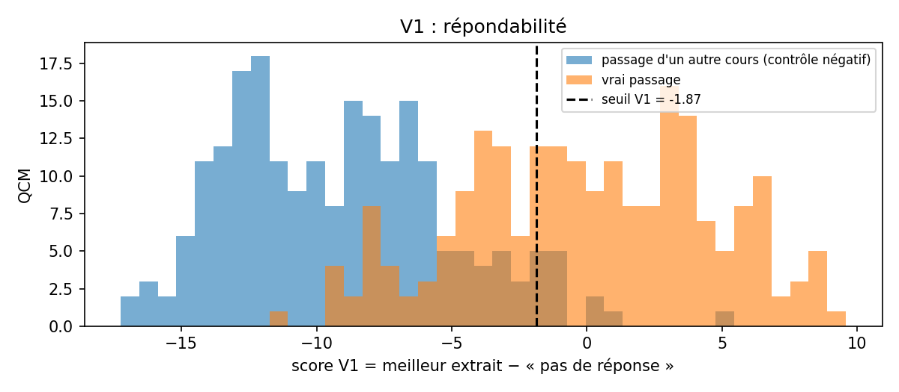

# Générer des QCM à partir d'un cours et rejeter automatiquement les défectueux

**TALN — Sujet 11 — Filière IA & Science des Données, 5e année — EMSI Rabat — 2026/2027**

> **État des résultats.** 212 QCM (97 base, 115 LLM) sont mesurés avec les contrôles de
> forme, le validateur V1–V3, les ablations et l'analyse des erreurs. L'évaluation
> humaine (60 QCM, deux évaluateurs) reste **À COMPLÉTER**. Tous les chiffres cités
> figurent dans `docs/article/resultats_auto.md`.

## Résumé

Nous transformons six cours de C (460 pages, 114 384 mots) en QCM, puis filtrons les
questions défectueuses. Deux générateurs sont comparés sur 120 passages : une base à
trous TF-IDF avec distracteurs par embeddings, et Qwen3-4B-Instruct-2507 (4 B, 4 bits).
Le validateur combine 7 règles de forme et 3 tests : répondabilité (SQuAD 2.0), unicité
de la réponse (NLI) et absence de distracteur correct (NLI). Le LLM couvre 95,8 % des
passages contre 80,8 %, et 20/20 diapositives de C6 contre 3/20 ; il pose des questions
de compréhension. Mais il est moins fiable : 79,1 % de forme, 51,3 % de V2, 42,6 % de
bonnes réponses les plus longues (p < 0,001), 31,2 % de clés fausses détectées. Le
filtre déployé accepte 25/97 QCM de base et 30/115 du LLM ; avec un seuil V1 calibré par
méthode, la base remonte à 61/97 et le LLM à 29/115. L'évaluation humaine en aveugle
reste à faire.

## 1. Introduction

Rédiger un QCM est coûteux : question non ambiguë, une seule réponse justifiée par le
cours, trois distracteurs plausibles mais faux. Un LLM produit ces éléments en quelques
secondes, mais avec des défauts récurrents : question sans réponse dans le support, deux
options correctes, distracteur vrai, clé erronée. L'enjeu est donc de **mesurer** et de
**filtrer**. Deux questions : (i) un validateur peut-il reproduire le jugement d'un
enseignant ? (ii) que gagne-t-on à filtrer ? Nous évaluons à trois niveaux : mesures
automatiques, défauts injectés, évaluation humaine en aveugle sur 60 QCM. Contributions :
un pipeline reproductible du PDF au QCM validé, un seuil de répondabilité calibré sans
annotation, des ablations, une analyse des erreurs.

## 2. État de l'art

**Génération de questions.** Mitkov et Ha (2003) masquent des termes clés d'une phrase
et choisissent des distracteurs par similarité distributionnelle : une base rapide,
déterministe et explicable, mais qui teste la reconnaissance d'une phrase plus que la
compréhension. Kurdi et al. (2020) recensent les méthodes d'évaluation et soulignent la
difficulté à juger une question autrement que par des humains.

**Génération avec des LLM.** Les modèles instruits produisent des questions de
compréhension et des distracteurs cohérents à partir d'un prompt. Les jeux français
(FQuAD, PIAF) servent à entraîner les modèles de validation, et la quantification
(QLoRA) rend un modèle de 4–7 milliards de paramètres exécutable sur une T4.

**Validation.** La cohérence aller-retour (Alberti et al., 2019) vérifie qu'un modèle de
questions-réponses retrouve la réponse attendue : c'est notre test V1. L'unicité et la
fausseté des distracteurs relèvent de l'inférence textuelle (MNLI, XNLI). Modèles :
XLM-R SQuAD 2.0, MiniLM NLI, Sentence-BERT, Qwen3-4B.

## 3. Données

Six supports publics sur le langage C, six auteurs, trois formats PDF (tableau 1). Les
PDF ne sont pas redistribués ; chaque auteur est cité. L'extraction produit du bruit
(accents LaTeX, ligatures, en-têtes, sommaires, tableaux, code, e-mails) ; des règles
explicites le retirent et le notebook compte les lignes par règle. Le **code est retiré**
car les modèles de validation ne l'exécutent pas et l'aplatissement lui fait perdre son
indentation. La part retirée va de 36,1 % (C1) à 63,2 % (C6). On obtient **415 passages**
de 150 à 300 mots (145 en moyenne, 458 tokens max), sans traverser deux sections. Un
**échantillon commun de 20 passages par cours** (120) sert aux deux générateurs.

**Tableau 1 — Corpus et passages**

| Cours | Auteur | Format | Pages | Mots brut | % retiré | Passages |
|---|---|---|---|---|---|---|
| C1 | A. Canteaut (INRIA) | LaTeX | 133 | 36 361 | 36,1 | 130 |
| C2 | P. Trau | polycopié | 71 | 20 292 | 38,6 | 81 |
| C3 | Elhdhili, Boucetta | Word | 76 | 21 115 | 37,3 | 88 |
| C4 | M. Qbadou (ENSET) | Word | 68 | 11 764 | 51,9 | 34 |
| C5 | non indiqué | LaTeX | 52 | 14 726 | 44,7 | 55 |
| C6 | J. Charbonnel (CNRS) | diapositives | 60 | 10 126 | 63,2 | 27 |
| **Total** | 6 cours | | **460** | **114 384** | **41,9** | **415** |

## 4. Méthode

### 4.1 Base de référence

Les termes clés de chaque passage sont classés par **TF-IDF** (uni- et bigrammes,
`min_df=3`, `max_df=0.3`, fréquence amortie, mots vides français). Le premier terme qui
apparaît une seule fois dans une phrase « propre » (8 à 35 mots, majuscule initiale,
point final, sans résidu de code) devient la réponse ; la phrase devient une question à
trous. Les distracteurs viennent des termes du corpus les plus proches en embeddings,
filtrés : similarité < 0,85 (pas de quasi-synonyme), autre famille de mots, même nombre
de mots, même classe grammaticale approchée, terme absent de la phrase. Les options sont
mélangées avec une graine liée au passage.

### 4.2 Générateur avancé

Le générateur est **Qwen3-4B-Instruct-2507** (Apache 2.0, 4,0 B, mode non-thinking),
quantifié en 4 bits (NF4, ~2,5 Go). Il remplace Qwen2.5-7B-Instruct : à licence
identique, presque deux fois moins de poids pour de meilleurs scores annoncés. Le prompt
énonce sept consignes qui préparent chacune un test : répondable uniquement avec le
passage, une seule bonne réponse, trois distracteurs faux mais plausibles, pas de
« toutes les réponses », question de compréhension, options courtes, question autonome.
Deux exemples rédigés hors corpus fixent le format JSON. La génération est gloutonne et
déterministe, avec une relance à 0,7 si le JSON est invalide ; le cache est étiqueté par
modèle. Sur 120 passages, **115 QCM sont valides (95,8 %)** : 109 au premier essai, 6
après relance, 5 échecs (4,2 %), **7,79 s par QCM** sur une T4. La couverture atteint
95,8 % contre 80,8 % pour la base, et **20/20 passages de C6 contre 3/20**. 85 % des
questions commencent par « quel(le) », 11 % par « pourquoi », 3 % par « comment » ;
aucune n'est à trous. La bonne réponse est recopiée du passage dans 51 % des cas, contre
100 % pour la base.

### 4.3 Contrôles de forme

Sept règles éliminent les défauts visibles sans comprendre le sens : options distinctes
(F1), pas d'option méta (F2), question non négative (F3), réponse absente de l'énoncé
(F4), question autonome (F5), options courtes et équilibrées (F6), énoncé bien formé
(F7). Chacune est testée unitairement. F3 ignore les négations de la phrase citée.

### 4.4 Validateur sémantique

**V1 — répondabilité.** XLM-RoBERTa fine-tuné sur SQuAD 2.0 lit le passage et la
question. Le score est la différence entre le meilleur extrait et la réponse spéciale
« pas de réponse ». Le seuil est fixé sans annotation : 95e centile des scores obtenus
en posant la même question à un passage d'un **autre cours**. Deux variantes sont
comparées : un seuil **global** sur les deux générateurs réunis (le filtre déployé) et
un seuil **par méthode**, qui garantit 5 % de fausse acceptation pour chacun.

**V2 — unicité.** Le NLI reçoit le passage et, pour chaque option *o*, l'hypothèse
« *question* Réponse : *o*. ». V2 passe si l'option correcte a la plus forte implication
et si celle-ci atteint 0,5.

**V3 — distracteurs faux.** V3 passe si aucun distracteur n'atteint 0,9. Ce seuil est
plus strict que V2 car le NLI est indulgent avec « question + réponse » ; V2 compare les
options entre elles. La prémisse est réduite aux **deux phrases les plus proches** de
l'hypothèse. Le validateur ignore la méthode ; la décision est une conjonction : accepté
si la forme, V1, V2 et V3 passent.

## 5. Protocole d'évaluation

**Mesures automatiques.** Couverture, taux de passage de chaque test, taux
d'acceptation, rendement (QCM acceptés pour 20 passages), et deux candidats naïfs qui ne
lisent pas le cours : choisir l'option la plus longue, ou l'option la plus proche de la
question selon les embeddings. Le hasard donne 25 %.

**Défauts injectés.** Déclarer un distracteur comme bonne réponse produit une clé
fausse : V2 doit échouer, et V3 devrait repérer que la vraie réponse, devenue
« distracteur », est confirmée. Le contrôle négatif de V1 joue le même rôle pour la
répondabilité.

**Évaluation humaine.** Soixante QCM sont tirés de façon **stratifiée** (méthode ×
décision, 15 par case), mélangés et présentés sous un identifiant neutre. Les deux
évaluateurs remplissent chacun leur grille sans se concerter, sans connaître la méthode
ni la décision. Critères : clarté (1–3), difficulté (1–3), unicité (0/1). Un QCM est
**acceptable** si la clarté vaut 2 ou 3 et si `unicité = 1` ; le verdict est déduit, non
demandé. L'accord est mesuré par le kappa de Cohen, pondéré pour les ordinaux (Landis et
Koch, 1977). L'apport du filtre est l'écart de qualité avant/après, avec un intervalle de
confiance par bootstrap (2 000 tirages).

**Ablations.** Retrait d'un contrôle à la fois ; variation des trois seuils ; modèle QA
(SQuAD 2.0 contre CamemBERT) ; formulation, taille de prémisse et modèle NLI (MiniLM
contre mDeBERTa) ; température du LLM.

## 6. Résultats

### 6.1 Génération et filtrage

La base produit **97 QCM sur 120 passages (80,8 %)** ; le LLM **115 (95,8 %)**. La
couverture dépend du format : 20/20 pour C3, 19/20 pour C1 et C2, 18/20 pour C4 et C5,
mais **3/20 pour C6** pour la base, contre **20/20 pour le LLM**. Le filtre déployé
(seuil V1 global) accepte **25 QCM de base (25,8 %)** et **30 du LLM (26,1 %)**.

**Tableau 2 — Taux de passage des tests (%)**

| Méthode | V1 | V2 | V3 | V1 et V2 et V3 | Acceptés |
|---|---|---|---|---|---|
| base | 44,3 | 89,7 | 69,1 | 25,8 | 25 / 97 |
| llm | 80,9 | 51,3 | 74,8 | 33,0 | 30 / 115 |

Le seuil V1 global vaut −1,87, le 95e centile des scores négatifs des deux générateurs
réunis. Les questions du LLM, souvent répondables hors du passage, ont des scores
négatifs élevés : le seuil global donne **0 % de fausse acceptation à la base et 9,6 %
au LLM**. La base passe donc de 96,9 % de V1 avec son propre seuil (−8,8) à 44,3 % ; son
AUC reste 0,993. Une calibration **par méthode** (tableau 14) rétablit 5 % pour chacun :
la base remonte à **61/97 (62,9 %)**, le LLM à **29/115 (25,2 %)**. Même à taux égal, le
V1 du LLM (73,9 %) reste très inférieur à celui de la base (96,9 %) : ses questions sont
moins ancrées dans le passage. Les tableaux 2 à 6 décrivent le filtre déployé ; le
tableau 14 donne la comparaison équitable.

Les contrôles de forme retirent 1 QCM de base et 24 du LLM (F1 10,4 %, F6 5,2 %, F5
3,5 %, F3 1,7 %, F4 0,9 %). Cascade du filtre global : base 1 forme, 54 V1, 7 V2, 10 V3
→ 25 acceptés ; LLM 24 forme, 16 V1, 37 V2, 8 V3 → 30 acceptés. **V2 est le principal
filtre du LLM**, V1 celui de la base avec le seuil global ; avec le seuil par méthode, la
cascade de la base redevient 1 forme, 3 V1, 7 V2, 10 V3 → 61 acceptés.

Sur les défauts injectés (tableau 8), V2 rejette 100 % des clés fausses (par
construction) et V3 en détecte 77,8 % pour la base, mais seulement **31,2 % pour le
LLM**. Le contrôle négatif de V1 donne une AUC de 0,993 pour la base (0,992 avec un
passage du même cours, 0 % de fausses acceptations) et 0,942 pour le LLM (0,944, 9,6 %
et 11,3 %) : le LLM répond davantage hors du passage.



*Figure 2 — Scores V1 ; le seuil global (−1,87) est le 95e centile des scores négatifs
des deux méthodes. Les scores négatifs du LLM sont plus élevés.*

### 6.2 Le LLM : couverture et faiblesses

Le LLM pose des questions de compréhension et couvre les diapositives, mais il est moins
fiable. Forme : 79,1 % contre 99 %, surtout des options dupliquées (F1 10,4 %) et
déséquilibrées (F6 5,2 %). V2 : 51,3 % contre 89,7 %, le NLI confirme souvent un
distracteur. V3 : 74,8 %, mais seulement **31,2 %** des clés fausses injectées sont
détectées, contre 77,8 % pour la base. **Biais de longueur** : la bonne réponse est la
plus longue dans **42,6 %** des cas (p < 0,001), et 50 % des QCM acceptés, contre 23,7 %
pour la base (p = 0,82). Un candidat qui choisit toujours l'option la plus longue obtient
42,6 % sur le LLM (50 % sur les acceptés) contre 23,7 % sur la base. Le LLM est plus
naturel et plus couvrant, mais plus facile à deviner et moins ancré dans le passage.

### 6.3 Évaluation humaine

**À COMPLÉTER** après les annotations : kappa par critère, qualité avant et après
filtre, précision des rejets, rappel des défauts, intervalles de confiance. Le filtre
est aussi évalué comme un **classifieur binaire** du verdict humain : matrice de
confusion 2×2, précision, rappel et F1 (tableau 13 de `resultats_auto.md`).

## 7. Ablations et sensibilité

**Tableau 3 — Ablation des contrôles (taux d'acceptation, %)**

| Variante | base | LLM |
|---|---|---|
| filtre complet | 25,8 | 26,1 |
| sans forme | 25,8 | 33,0 |
| sans V1 | 64,9 | 33,0 |
| sans V2 | 28,9 | 47,0 |
| sans V3 | 36,1 | 33,0 |
| forme seule | 99,0 | 79,1 |
| aucun filtre | 100,0 | 100,0 |

Pour le LLM, V2 pèse le plus (+20,9 points sans V2), puis la forme, V1 et V3 (+6,9
chacun). Pour la base avec le seuil global, V1 pèse le plus (+39,1), puis V3 (+10,3) et
V2 (+3,1) ; avec le seuil par méthode, V1 ne retire plus que 3 QCM et V3/V2 redeviennent
les principaux filtres. Le filtre corrige donc surtout l'unicité et la forme du LLM, et
les distracteurs de la base.

**Seuils.** L'acceptation est stable pour V2 (base 25,8–26,8 %, LLM 16,5–29,6 % entre
0,3 et 0,8) et V3 (base 11,3–36,1 %, LLM 11,3–33,0 % entre 0,6 et 0,99). Pour V1, la
base varie de 18,6 à 49,5 % et le LLM de 24,3 à 33,0 % entre les centiles 0,80 et 0,99 :
la sensibilité de la base vient du seuil global, dominé par les scores négatifs du LLM.
Le seuil de V3 reste le réglage critique.


*Figure 3 — Taux d'acceptation selon chaque seuil, les autres à leur valeur par défaut
(pointillés). Les deux générateurs sont tracés séparément.*

**Modèle de questions-réponses.** À 5 % de fausses acceptations, SQuAD 2.0 accepte
**96,9 %** des questions de base et **73,9 %** du LLM, contre **30,9 %** et **27,8 %**
pour CamemBERT ; l'AUC est 0,993 (base) et 0,942 (LLM), contre 0,786 et 0,780. Le modèle
avec « pas de réponse » reste déterminant, mais le LLM est plus difficile à vérifier.

**Tableau 4 — Ablations du modèle NLI**

| Variante | Discernement base (%) | % V2+V3 base | % V2+V3 LLM | Clé fausse détectée (%) |
|---|---|---|---|---|
| B, 2 phrases (retenu) | 90,7 | 64,9 | 41,7 | 64,3 |
| A, 2 phrases (phrase complétée) | 64,9 | 16,5 | — | 95,2 |
| B, 1 phrase | 91,8 | 85,6 | 39,1 | 24,8 |
| B, 4 phrases | 86,6 | 54,6 | 37,4 | 60,5 |
| B, 2 phrases, mDeBERTa | 69,1 | 21,6 | 48,7 | 37,1 |

La formulation compte : avec la phrase complétée (A), le NLI préfère la bonne réponse
dans 64,9 % des cas, contre 90,7 % avec « question + réponse ». Le taux de détection de
(A) est trompeur : cette formulation rejette presque tout (84 % des QCM, bons compris).
Une prémisse d'une phrase détruit la détection des clés fausses (24,8 %) ; quatre phrases
diluent le signal (60,5 %). mDeBERTa ne domine pas : 69,1 % de discernement sur la base,
21,6 % de V2+V3 base, 37,1 % de clés fausses ; il améliore seulement le V2+V3 du LLM
(48,7 % contre 41,7 %). Le petit MiniLM reste le meilleur compromis. Le biais de longueur
de la base est absent (23,7 %, p = 0,82), celui du LLM est fort (42,6 %, p < 0,001).

**Température.** Le glouton donne 25,6 % d'acceptation et 97,5 % de JSON valide ; à 0,7,
27,8 % et 90,0 % ; à 1,0, 34,2 % et 95,0 %. L'effet est modeste et la diversité ne change
pas (29–30 % de mots nouveaux) : le glouton reste le choix reproductible.

## 8. Analyse des erreurs

**Tableau 5 — Typologie des rejets (nombre de QCM)**

| Catégorie | base | LLM |
|---|---|---|
| texte source dégradé | 2 | 5 |
| défaut de forme | 1 | 24 |
| réponse introuvable (V1) | 52 | 15 |
| bonne réponse non confirmée (V2) | 7 | 34 |
| distracteur proche de la réponse | 9 | 3 |
| distracteur confirmé sans être proche | 1 | 4 |
| **Total** | **72** | **85** |

La base accumule 52 rejets V1 avec le seuil global ; avec le seuil par méthode, elle n'en
aurait que 3 et **36 rejets au total**, proche de l'ancienne typologie. Le LLM a **34
rejets V2** (le NLI confirme souvent un distracteur), 24 défauts de forme et 15 rejets
V1 ; ses distracteurs proches sont moins nombreux (3 contre 9), mais plus souvent
confirmés.

Les faux positifs du NLI existent : pour « conçu par Dennis _____ », le modèle juge
« livre » confirmé ; pour « un tableau à deux _____ est un tableau de tableaux », il
préfère « tailles » à « dimensions ». Les deux se défendent : c'est l'exemple de
désaccord du guide. Un exemple de faiblesse du LLM : « Quel organisme a formalisé la
norme C en 1989 ? » (ANSI) ; le NLI confirme aussi ISO et Bell Labs, donc V2 et V3
échouent. Le contrôle négatif accepte 9,6 % de ses questions sur un passage sans rapport.
Deux erreurs viennent de l'extraction : un fragment de tableau et une phrase d'interface
web (`… du _____:...`, avec « cliquez » et « lien »).

**Hallucinations.** La justification du LLM contient moins de 50 % de mots du passage
dans **0 %** des QCM : le LLM copie le passage. Cette mesure est lexicale : elle ne
prouve pas que la justification justifie la réponse, seulement qu'elle n'est pas
inventée. Les faux rejets et fausses acceptations seront mesurés avec les annotations.

## 9. Limites et éthique

**Données.** Six cours, une matière, une langue : les conclusions ne se généralisent
pas. Le retrait du code interdit les questions de lecture de programme et laisse des
phrases orphelines. Les diapositives produisent peu de passages pour la base, même si le
LLM les reformule mieux.

**Générateurs.** La base ne pose que des questions à trous : elle teste la mémoire du
texte. Le LLM est plus couvrant et plus naturel, mais **moins fiable** : 79,1 % de forme,
51,3 % de V2, 42,6 % de biais de longueur, 31,2 % de clés fausses détectées, 9,6 % de
fausses acceptations ; ses questions sont parfois de culture générale. Un seul LLM, un
seul prompt : l'ablation SmolLM3-3B reste à faire. Le cache est étiqueté par modèle, pas
par version du prompt.

**Validateur et calibration.** Un distracteur vrai en C mais absent du texte est accepté ;
une bonne réponse formulée autrement peut être rejetée. Le NLI est indulgent, mDeBERTa
n'améliore pas clairement la situation, et le QA est entraîné en anglais. Le seuil global
donne 0 % de fausse acceptation à la base et 9,6 % au LLM ; le seuil par méthode rétablit
5 % pour chacun (tableau 14), mais les distributions restent différentes. Les seuils ne
sont pas optimisés : les régler sur les 60 QCM puis mesurer sur ces mêmes QCM
surestimerait les performances.

**Évaluation.** 60 QCM et deux évaluateurs donnent des intervalles de ±15 à 20 points par
case ; les évaluateurs sont les auteurs et reconnaissent les questions à trous.
L'annotation est en cours.

**Reproductibilité.** Graines fixées et décodage glouton, mais le calcul 4 bits varie
d'une carte à l'autre et les modèles peuvent évoluer ; les caches figent les résultats.

**Éthique.** Les supports appartiennent à leurs auteurs : PDF non versionnés, dépôt sans
les PDF, sources citées ; une diffusion publique des QCM demanderait leur accord. Les
adresses électroniques sont supprimées et les grilles ne contiennent rien sur les
évaluateurs. Un QCM faux pénalise un étudiant qui a juste : le système est un **outil
d'aide**, l'enseignant relit chaque question, et les questions générées sont signalées
comme telles.

## 10. Conclusion

Quatre enseignements. Le LLM **couvre mieux** et pose de vraies questions de
compréhension : 95,8 % des passages, 20/20 sur C6, 85 % de questions en « quel(le) »
contre 100 % de questions à trous pour la base. Mais il est **moins fiable** : 79,1 % de
forme, 51,3 % de V2, 42,6 % de biais de longueur, 31,2 % de clés fausses détectées, 9,6 %
de fausses acceptations. Le filtre ne joue donc pas le même rôle : il corrige surtout
l'unicité et la forme du LLM, et les distracteurs de la base.

La **calibration de V1** change la lecture. Le seuil global donne 0 % de fausse
acceptation à la base et 9,6 % au LLM ; il fait chuter la base à 25/97 acceptés. Le seuil
par méthode rétablit 5 % pour chacun : base 61/97 (62,9 %), LLM 29/115 (25,2 %). Même à
taux égal, le V1 du LLM (73,9 %) reste très inférieur à celui de la base (96,9 %) : le
problème du LLM est réel, pas seulement un artefact de seuil.

Le **choix des modèles** compte : SQuAD 2.0 reste très supérieur à CamemBERT (AUC 0,993
contre 0,786 sur la base), et MiniLM reste le meilleur compromis face à mDeBERTa. La
température du LLM a un effet modeste (25,6 % à 34,2 %) ; le glouton reste reproductible.

La suite est tracée : les deux grilles d'annotation des 60 QCM, puis le kappa, la
qualité avant/après filtre et la matrice de confusion. Les métriques automatiques ne
départagent pas la base et le LLM : la base est plus fiable, le LLM plus riche. Seule
l'évaluation humaine dira si le gain de couverture compense la perte de fiabilité.

## Références

Alberti, C., Andor, D., Pitler, E., Devlin, J., & Collins, M. (2019). Synthetic QA
corpora generation with roundtrip consistency. *ACL*.

Cohen, J. (1960). A coefficient of agreement for nominal scales. *Educational and
Psychological Measurement*, 20(1), 37–46.

Conneau, A., Rinott, R., Lample, G., Williams, A., Bowman, S., Schwenk, H., & Stoyanov,
V. (2018). XNLI: Evaluating cross-lingual sentence representations. *EMNLP*.

Conneau, A., Khandelwal, K., Goyal, N., Chaudhary, V., Wenzek, G., Guzmán, F., Grave,
E., Ott, M., Zettlemoyer, L., & Stoyanov, V. (2020). Unsupervised cross-lingual
representation learning at scale. *ACL*.

Dettmers, T., Pagnoni, A., Holtzman, A., & Zettlemoyer, L. (2023). QLoRA: Efficient
finetuning of quantized LLMs. *NeurIPS*.

d'Hoffschmidt, M., Belblidia, W., Brendlé, T., Heinrich, Q., & Vidal, M. (2020). FQuAD:
French question answering dataset. *Findings of EMNLP*.

He, P., Gao, J., & Chen, W. (2021). DeBERTaV3: Improving DeBERTa using ELECTRA-style
pre-training with gradient-disentangled embedding sharing. *ICLR*.

Keraron, R., Lancrenon, G., Bras, M., Allary, F., Moy, S., Scialom, T., & Sagot, B.
(2020). Project PIAF: Building a native French question-answering dataset. *LREC*.

Kurdi, G., Leo, J., Parsia, B., Sattler, U., & Al-Emari, S. (2020). A systematic review
of automatic question generation for educational purposes. *International Journal of
Artificial Intelligence in Education*, 30, 121–204.

Landis, J. R., & Koch, G. G. (1977). The measurement of observer agreement for
categorical data. *Biometrics*, 33(1), 159–174.

Mitkov, R., & Ha, L. A. (2003). Computer-aided generation of multiple-choice tests.
*ACL Workshop on Building Educational Applications Using NLP*.

Qwen Team (2025). Qwen3 technical report. *arXiv:2505.09388*.

Rajpurkar, P., Jia, R., & Liang, P. (2018). Know what you don't know: Unanswerable
questions for SQuAD. *ACL*.

Reimers, N., & Gurevych, I. (2019). Sentence-BERT: Sentence embeddings using Siamese
BERT-networks. *EMNLP*.

Williams, A., Nangia, N., & Bowman, S. (2018). A broad-coverage challenge corpus for
sentence understanding through inference. *NAACL*.

## Annexe — reproduction

```bash
pip install -r requirements.txt
jupyter notebook notebooks/QCM_generation_validation.ipynb   # étapes 0 à 11
python3 scripts/tableaux_resultats.py                        # resultats_auto.md
python3 scripts/verifier_sorties.py                          # cohérence des sorties
```

Les étapes 5 et 10.3 à 10.5 ont été exécutées sur Colab T4. L'étape 9 (annotations)
reste à faire : les deux évaluateurs remplissent les grilles, puis
`scripts/tableaux_resultats.py` calcule le kappa, l'apport du filtre et la matrice de
confusion. Les figures sont dans `outputs/figures/`.
