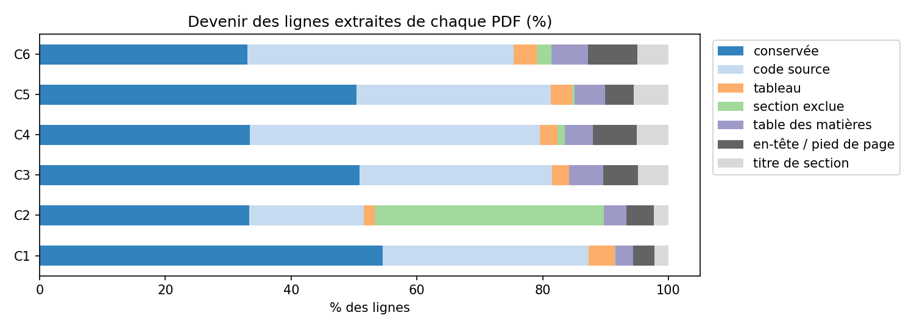
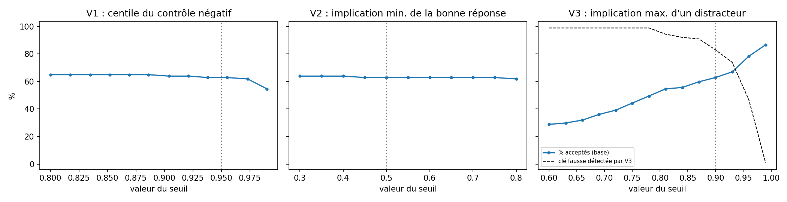

# Générer des QCM à partir d'un cours et rejeter automatiquement les défectueux

**TALN — Sujet 11 — Filière IA & Science des Données, 5e année — EMSI Rabat — 2026/2027**

> **État des résultats.** La base de référence, les contrôles de forme, le validateur
> V1–V3, les ablations et l'analyse des erreurs sont mesurés sur 97 QCM. La génération
> par LLM (GPU) et l'évaluation humaine sont marquées **À COMPLÉTER** ; les tableaux
> correspondants sont régénérés par `scripts/tableaux_resultats.py`. Tous les chiffres
> cités figurent dans `docs/article/resultats_auto.md`.

## Résumé

Nous transformons six cours de langage C (460 pages, 114 384 mots) en questions à
choix multiples, puis filtrons automatiquement les questions défectueuses. Deux
générateurs sont comparés sur un même échantillon de 120 passages : une base sans
modèle de langage (questions à trous TF-IDF, distracteurs par embeddings) et un LLM
ouvert instruit (Qwen3-4B-Instruct-2507, 4 milliards de paramètres). Le validateur
enchaîne sept règles de forme et trois tests sémantiques : répondabilité par un modèle
de questions-réponses SQuAD 2.0 (V1),
unicité de la bonne réponse (V2) et absence de distracteur correct (V3). Sur la base,
80,8 % des passages produisent un QCM et 62,9 % des QCM sont acceptés. V3 porte
l'essentiel du filtrage : sans lui, le taux d'acceptation passerait à 86,6 %. Le seuil
de V1, calibré sans annotation par un contrôle négatif, sépare les vrais passages des
passages sans rapport avec une AUC de 0,993 (0,992 avec des passages du même cours).
Les ablations montrent que le choix des modèles pèse plus que le réglage des seuils.

## 1. Introduction

Rédiger un QCM est coûteux : il faut une question non ambiguë, une seule réponse
justifiée par le cours et trois distracteurs plausibles mais faux. Un modèle de langage
produit ces quatre éléments en quelques secondes, mais avec des défauts récurrents :
question sans réponse dans le support, deux options correctes, distracteur en réalité
vrai, clé de correction erronée. L'enjeu n'est donc pas de faire parler un modèle, mais
de **mesurer** la qualité de ses sorties et de **filtrer** ce qui est inutilisable.

Deux questions guident le travail. (i) Un validateur automatique peut-il reproduire le
jugement d'un enseignant qui vérifie une question sur son cours ? (ii) Que gagne-t-on à
filtrer, en précision et en volume ? Nous construisons un système complet et
l'évaluons à trois niveaux : mesures automatiques sur tous les QCM, défauts injectés
dont la nature est connue, évaluation humaine en aveugle sur 60 QCM.

Nos contributions : un pipeline reproductible du PDF au QCM validé ; un seuil de
répondabilité calibré **sans annotation** ; une comparaison systématique des composants
par ablation ; une analyse des erreurs séparant les défauts de l'extraction, du
générateur et du validateur.

## 2. État de l'art

**Génération de questions.** Mitkov et Ha (2003) produisent des questions à trous en
masquant des termes importants d'une phrase, puis choisissent des distracteurs par
similarité distributionnelle : une base de référence rapide, déterministe et
explicable, mais qui teste la reconnaissance d'une phrase plus que la compréhension.
Kurdi et al. (2020) recensent les méthodes d'évaluation et soulignent la difficulté à
juger une question autrement que par des humains.

**Génération avec des LLM.** Les modèles instruits produisent des questions de
compréhension et des distracteurs cohérents à partir d'un prompt. Les jeux de questions-
réponses français (FQuAD, d'Hoffschmidt et al., 2020 ; PIAF, Keraron et al., 2020)
servent à entraîner les modèles de validation, et la quantification (QLoRA, Dettmers et
al., 2023) rend un modèle de 7 milliards de paramètres exécutable sur un GPU de 15 Go.

**Validation automatique.** La cohérence aller-retour (Alberti et al., 2019) vérifie
qu'un modèle de questions-réponses retrouve la réponse attendue : c'est notre test V1.
L'unicité de la réponse et la fausseté des distracteurs relèvent de l'inférence
textuelle (MNLI, Williams et al., 2018 ; XNLI pour le multilingue, Conneau et al.,
2018). Les règles de forme sont des contrôles classiques de génération de QCM.

**Modèles.** XLM-RoBERTa (Conneau et al., 2020) fine-tuné sur SQuAD 2.0 (Rajpurkar et
al., 2018) pour V1, un petit modèle NLI multilingue (MNLI + XNLI) pour V2 et V3,
Sentence-BERT (Reimers et Gurevych, 2019) pour les embeddings, Qwen3-4B-Instruct-2507
(Qwen Team, 2025) pour la génération.

## 3. Données

Six supports publics sur le langage C, de six auteurs, en trois formats PDF. Ce choix
donne un cas d'usage réaliste et une même notion expliquée six fois, ce qui permet de
comparer les styles. Les PDF ne sont pas redistribués ; chaque auteur est cité.

**Tableau 1 — Corpus et passages**

| Cours | Auteur | Format | Pages | Mots brut | % retiré | Passages |
|---|---|---|---|---|---|---|
| C1 | A. Canteaut (INRIA) | LaTeX | 133 | 36 361 | 36,1 | 130 |
| C2 | P. Trau | polycopié | 71 | 20 292 | 38,6 | 81 |
| C3 | Elhdhili, Boucetta | Word | 76 | 21 115 | 37,3 | 88 |
| C4 | M. Qbadou (ENSET) | Word | 68 | 11 764 | 51,9 | 34 |
| C5 | non indiqué | LaTeX | 52 | 14 726 | 44,7 | 55 |
| C6 | J. Charbonnel (CNRS) | diapositives | 60 | 10 126 | 63,2 | 27 |
| **Total** | 6 cours | | **460** | **114 384** | **41,9** | **415** |

**Nettoyage.** L'extraction PDF produit du bruit régulier, repéré en lisant les six
sorties brutes : accents LaTeX détachés, ligatures, espaces manquants, sommaires,
en-têtes répétés, tableaux de valeurs, code source, exercices et adresses
électroniques. Des règles explicites traitent chaque cas et le notebook compte les
lignes retirées par règle ; la part supprimée va de 36,1 % (C1) à 63,2 % (C6). Le
**code est retiré** parce que les modèles de validation, entraînés sur de la prose, ne
savent pas exécuter un programme, et parce que son aplatissement lui fait perdre
indentation et retours à la ligne ; les notions restent expliquées autour.



*Figure 1 — Part des lignes conservées ou retirées, par règle, pour chaque cours.*

**Passages.** Chaque cours est découpé en passages de 150 à 300 mots, sans traverser
deux sections. La longueur est contrainte par le validateur (512 tokens, question
comprise) et vérifiée avec le tokenizer de CamemBERT ; les passages trop longs sont
coupés entre deux phrases. On obtient 415 passages (145 mots en moyenne, 458 tokens au
maximum). Un **échantillon commun de 20 passages par cours** (120 passages) sert à
comparer les générateurs sur les mêmes entrées.

## 4. Méthode

### 4.1 Base de référence

Les termes clés de chaque passage sont classés par **TF-IDF** (uni- et bigrammes,
`min_df=3`, `max_df=0.3`, fréquence amortie, liste d'arrêt française). Le premier terme
qui apparaît une seule fois dans une phrase « propre » (8 à 35 mots, majuscule initiale,
point final, sans résidu de code) devient la réponse ; la phrase devient une question à
trous. Les distracteurs viennent des termes du même corpus les plus proches en
embeddings, filtrés : similarité inférieure à 0,85 (pas de quasi-synonyme), autre
famille de mots, même nombre de mots, même classe grammaticale approchée, terme absent
de la phrase. Les options sont mélangées avec une graine liée au passage.

### 4.2 Générateur avancé

Le générateur avancé est Qwen3-4B-Instruct-2507 (Apache 2.0, 4,0 milliards de
paramètres, mode non-thinking), quantifié en 4 bits (NF4) : environ 2,5 Go de mémoire
GPU. Il remplace Qwen2.5-7B-Instruct, choisi au démarrage du projet : à licence
identique, il divise les poids par presque deux pour de meilleurs scores annoncés
(MMLU-Pro 69,6 ; GPQA 62,0). Le détail des candidats (SmolLM3-3B, Gemma 3 4B,
Qwen3-1.7B) et de leurs licences est dans `docs/llm/CHOIX_MODELE.md`. Le prompt énonce
sept consignes qui préparent chacune un test du validateur : répondable uniquement avec
le passage, une seule bonne réponse, trois distracteurs faux
mais plausibles, pas de « toutes les réponses », question de compréhension, options
courtes et équilibrées, question autonome. Deux exemples rédigés hors corpus fixent le
format JSON (`question`, `bonne_reponse`, `distracteurs`, `justification`). La
génération est gloutonne et déterministe, avec une relance à température 0,7 si le JSON
est invalide ; les échecs sont comptés et les sorties mises en cache avec le nom du
modèle, pour qu'un cache produit par un autre modèle soit refusé. **À COMPLÉTER** après
l'étape 5 : QCM produits, taux de JSON valide, temps par QCM, couverture par cours.

### 4.3 Contrôles de forme

Sept règles éliminent les défauts visibles sans comprendre le sens : options
distinctes (F1), pas d'option méta (F2), question non négative (F3), réponse absente de
l'énoncé (F4), question autonome (F5), options courtes et équilibrées (F6), énoncé bien
formé (F7). Chacune est testée unitairement sur un QCM fabriqué. F3 ignore les
négations de la phrase citée, pour ne pas confondre « le compilateur ne vérifie pas »
avec une question négative.

### 4.4 Validateur sémantique

**V1 — répondabilité.** Un modèle de questions-réponses (XLM-RoBERTa fine-tuné sur
SQuAD 2.0) lit le passage et la question. Son score est la différence entre le meilleur
extrait du passage et la réponse spéciale « pas de réponse » : un score élevé signifie
que le modèle préfère un extrait du texte à l'absence de réponse. Le seuil est fixé
**sans annotation** : il vaut le 95e centile des scores obtenus en posant la même
question à un passage d'un **autre cours**. Par construction, au plus 5 % des questions
sans réponse sont acceptées.

**V2 — unicité.** Le modèle NLI reçoit le passage comme prémisse et, pour chaque option
*o*, l'hypothèse « *question* Réponse : *o*. ». V2 passe si l'option marquée correcte a
la plus forte implication et si celle-ci atteint 0,5.

**V3 — distracteurs faux.** V3 passe si aucun distracteur n'atteint une implication de
0,9. Ce seuil est plus strict que celui de V2 parce que le modèle est indulgent avec la
formulation « question + réponse » ; V2 compare les options entre elles, ce qui neutralise
en partie ce biais. La prémisse est réduite aux **deux phrases du passage les plus
proches de l'hypothèse**, car les modèles NLI sont entraînés sur des prémisses courtes.

Le validateur ignore la méthode qui a produit le QCM : base et LLM sont jugés par les
mêmes modèles et les mêmes seuils. La décision finale est une **conjonction** : accepté
si la forme, V1, V2 et V3 passent.

## 5. Protocole d'évaluation

**Mesures automatiques.** Couverture (part des passages produisant un QCM), taux de
passage de chaque test, taux d'acceptation, rendement (QCM acceptés pour 20 passages),
et réussite de deux candidats naïfs qui ne lisent pas le cours : choisir l'option la
plus longue, ou l'option la plus proche de la question selon les embeddings. Le hasard
donne 25 %.

**Défauts injectés.** Déclarer un distracteur comme bonne réponse produit une clé de
correction fausse : V2 doit échouer, et V3 devrait repérer que la vraie réponse, devenue
« distracteur », est confirmée par le texte. Le contrôle négatif de V1 joue le même rôle
pour la répondabilité.

**Évaluation humaine.** Soixante QCM sont tirés de façon **stratifiée** (méthode ×
décision du filtre, 15 par case), mélangés et présentés sous un identifiant neutre. Les
deux évaluateurs remplissent chacun leur grille sans se concerter et sans connaître la
méthode ni la décision. Critères : clarté (1–3), difficulté (1–3), unicité (0/1). Un QCM
est **acceptable** si la clarté vaut 2 ou 3 et si `unicité = 1` ; ce verdict est déduit, non
demandé, pour éviter un jugement global subjectif. L'accord est mesuré par le kappa de
Cohen, pondéré pour les critères ordinaux, selon l'échelle de Landis et Koch (1977).
L'apport du filtre est l'écart entre qualité après et avant filtrage, avec des
intervalles de confiance par bootstrap (2 000 rééchantillonnages).

**Ablations.** Retrait d'un contrôle à la fois ; variation des trois seuils ; modèle de
questions-réponses (SQuAD 2.0 contre CamemBERT FQuAD/PIAF) ; formulation de l'hypothèse
NLI (phrase complétée contre question + réponse) ; taille de la prémisse (1, 2 ou 4
phrases) ; modèle NLI plus grand (mDeBERTa-v3, GPU) ; température du LLM.

## 6. Résultats

### 6.1 Génération et filtrage

La base produit **97 QCM sur 120 passages (80,8 %)**. La couverture dépend du format :
20/20 pour C3, 19/20 pour C1 et C2, 18/20 pour C4 et C5, mais **3/20 pour C6**, dont les
diapositives n'offrent presque aucune phrase complète (tableau 7 de
`resultats_auto.md`). Sur ces 97 QCM, **61 sont acceptés (62,9 %)**, soit 50,8 QCM
utilisables pour 120 passages.

**Tableau 2 — Taux de passage des tests (%)**

| Méthode | V1 | V2 | V3 | V1 et V2 et V3 | Acceptés |
|---|---|---|---|---|---|
| base | 96,9 | 89,7 | 69,1 | 62,9 | 61 / 97 |

Les contrôles de forme ne rejettent qu'un QCM (F1, deux options identiques à l'accent
près). Le filtrage est donc presque entièrement sémantique, et **V3 en porte
l'essentiel** : dans la cascade, la forme retire 1 QCM, V1 3, V2 9, V3 23, et 61 sont
acceptés.

Sur les défauts injectés (tableau 8 de `resultats_auto.md`), V2 rejette 100 % des clés
fausses (par construction) et V3 en détecte 77,8 %. Le contrôle négatif de V1 donne une
AUC de 0,993 ; avec un passage **du même cours**, l'AUC reste à 0,992 et le taux de
questions sans réponse acceptées passe de 5,2 % à 4,1 % : le contrôle plus difficile ne
dégrade pas V1, et le taux de fausse acceptation annoncé (5 %) est réaliste.


*Figure 2 — Distribution des scores V1 ; le seuil est le 95e centile des scores négatifs.*

### 6.2 Base contre LLM

**À COMPLÉTER** après l'étape 5 : couverture, type de question, part de réponses
extractives, taux de passage de chaque test, rendement par cours. Les tableaux de
`resultats_auto.md` ajouteront automatiquement une ligne `llm`.

### 6.3 Évaluation humaine

**À COMPLÉTER** après les annotations : kappa par critère, qualité avant et après
filtre, précision des rejets, rappel des défauts, intervalles de confiance.

## 7. Ablations et sensibilité

**Tableau 3 — Ablation des contrôles (taux d'acceptation, base)**

| Variante | % acceptés |
|---|---|
| filtre complet | 62,9 |
| sans forme | 62,9 |
| sans V1 | 64,9 |
| sans V2 | 66,0 |
| **sans V3** | **86,6** |
| forme seule | 99,0 |
| aucun filtre | 100,0 |

V3 pèse le plus (+23,7 points s'il disparaît). Les autres contrôles ne retirent que
quelques QCM, ce qui est cohérent avec la nature de la base : ses réponses sont
recopiées du passage, donc répondables et souvent confirmées. L'intérêt de V1 et V2
apparaîtra surtout sur les QCM du LLM, dont les réponses sont reformulées.

**Seuils.** Le taux d'acceptation est stable pour V1 (54,6–64,9 % entre les centiles
0,80 et 0,99) et V2 (61,9–63,9 % entre 0,3 et 0,8), mais très sensible à V3 (28,9–86,6 %
entre 0,6 et 0,99). Le seuil de V3 est le réglage critique — et celui dont la valeur
(0,9) est la moins justifiée par une mesure.



*Figure 3 — Taux d'acceptation selon chaque seuil, les autres restant à leur valeur par
défaut (pointillés). Seule la courbe de V3 est fortement pentue.*

**Modèle de questions-réponses.** À 5 % de fausses acceptations, SQuAD 2.0 accepte
**96,9 %** des questions posées à leur vrai passage, contre **30,9 %** pour CamemBERT
FQuAD/PIAF, avec une AUC de 0,993 contre 0,786. Disposer d'exemples « sans réponse » est
donc déterminant : un modèle entraîné uniquement sur des questions répondables renvoie
toujours un extrait, et sa confiance ne mesure pas la répondabilité.

**Tableau 4 — Ablations du modèle NLI (base)**

| Variante | Discernement (%) | % V2+V3 | Clé fausse détectée (%) |
|---|---|---|---|
| B, 2 phrases (retenu) | 90,7 | 64,9 | 83,0 |
| A, 2 phrases (phrase complétée) | 64,9 | 16,5 | 95,2 |
| B, 1 phrase | 91,8 | 85,6 | 24,7 |
| B, 4 phrases | 86,6 | 54,6 | 69,0 |

La formulation compte : avec la phrase complétée (A), le NLI préfère la bonne réponse
dans 64,9 % des cas, contre 90,7 % avec « question + réponse ». Le taux élevé de
détection de (A) est trompeur : cette formulation rejette presque tout (84 % des QCM,
bons compris). Une prémisse d'une phrase détruit la détection des clés fausses
(24,7 %) ; quatre phrases diluent le signal (69,0 %). La dernière colonne suit le
protocole de la section 10.2 du notebook (le tirage de la section 7.5 donne 77,8 %).
Le biais de longueur est absent : 24,7 % (p = 1,0 contre 25 %).

## 8. Analyse des erreurs

**Tableau 5 — Typologie des rejets (base)**

| Catégorie | QCM |
|---|---|
| texte source dégradé | 1 |
| défaut de forme | 1 |
| réponse introuvable (V1) | 3 |
| bonne réponse non confirmée (V2) | 8 |
| distracteur proche de la réponse | 21 |
| distracteur confirmé sans être proche | 2 |

Plus de la moitié des rejets (21/36) sont des **distracteurs proches de la bonne
réponse** (similarité d'au moins 0,6), effet direct de la méthode : la base choisit ses
distracteurs parmi les voisins de la réponse et n'écarte que les quasi-synonymes
(d'au moins 0,85). Certains rejets sont justifiés : pour « 32 _____ pour un DEC alpha »,
« octets » est défendable face à « bits ». D'autres illustrent le compromis inverse :
plus un distracteur est proche, plus il est plausible, mais plus il risque d'être vrai.

Les faux positifs du NLI existent : pour « conçu par Dennis _____ », le modèle juge
« livre » confirmé. À l'inverse, « bonne réponse non confirmée » contient des cas
discutables : pour « un tableau à deux _____ est un tableau de tableaux », le modèle
préfère « tailles » à « dimensions ». Les deux se défendent : c'est l'exemple de
désaccord du guide d'annotation.

Deux erreurs viennent de plus loin : un QCM classé « texte source dégradé » cite un
fragment de tableau extrait du PDF, et un autre, rejeté par V1, est construit sur une
phrase d'interface web (`… du _____:...`, avec « cliquez » et « lien » parmi les
options). Une règle rejetant les lignes mêlant chiffres et identifiants supprimerait la
première.

**Erreurs du validateur et hallucinations du LLM. À COMPLÉTER** à partir des
annotations : faux rejets, fausses acceptations, et part des justifications inventées
(moins de 50 % des mots présents dans le passage).

## 9. Limites et éthique

**Données.** Six cours, une matière, une langue : les conclusions ne se généralisent
pas. Le retrait du code interdit les questions de lecture de programme, alors que c'est
central en C, et laisse des phrases orphelines à l'origine d'une partie des rejets. Les
diapositives produisent peu de passages exploitables.

**Générateurs.** La base ne pose que des questions à trous : elle teste la mémoire du
texte, pas la compréhension. Un seul LLM, un seul prompt, sans fine-tuning : un autre
modèle pourrait changer le classement. Le choix de Qwen3-4B repose sur des benchmarks
publics, pas sur notre corpus ; l'ablation SmolLM3-3B (français natif) reste à faire. La
génération LLM n'est pas encore mesurée ici.

**Validateur.** Il ne connaît que le passage : un distracteur vrai en C mais absent du
texte est jugé non confirmé, donc accepté ; une bonne réponse formulée autrement peut
être rejetée. Le NLI est petit et indulgent, d'où les fausses alertes de V3. Le modèle
de questions-réponses est entraîné en anglais et fonctionne en français par transfert.
Les seuils sont justifiés mais non optimisés : les régler sur les 60 QCM de l'évaluation
puis mesurer la qualité sur ces mêmes QCM surestimerait les performances.

**Évaluation.** 60 QCM et deux évaluateurs donnent des intervalles de ±15 à 20 points
par case ; les évaluateurs sont les auteurs et reconnaissent les questions à trous.

**Reproductibilité.** Graines fixées et décodage glouton, mais le calcul 4 bits varie
d'une carte à l'autre et les modèles peuvent évoluer ; les caches figent les résultats.

**Éthique.** Les supports appartiennent à leurs auteurs : PDF non versionnés, dépôt
privé, sources citées ; une diffusion publique des QCM demanderait leur accord. Les
adresses électroniques sont supprimées dès le nettoyage et les grilles ne contiennent
rien sur les évaluateurs. Enfin, un QCM faux pénalise un étudiant qui a juste : le
système est un **outil d'aide**, l'enseignant relit chaque question, et les questions
générées sont signalées comme telles.

## 10. Conclusion

Trois enseignements. Le filtrage utile est **sémantique** : les règles de forme ne
détectent presque rien sur un générateur qui recopie le cours, alors que V3 retire un
quart des QCM. Le **choix des modèles** compte plus que le réglage des seuils : passer à
un modèle de questions-réponses avec « pas de réponse » fait grimper l'AUC de 0,786 à
0,993, tandis que le seuil de V1 reste stable sur une large plage. Enfin, la
**calibration sans annotation** est possible : un contrôle négatif suffit à fixer un
seuil défendable, qui tient même avec des passages du même cours.

La suite est tracée : génération LLM sur GPU, annotation des 60 QCM, calcul de l'apport
du filtre. Les tableaux se régénéreront automatiquement, et les questions ouvertes —
précision des rejets de V3, valeur optimale de son seuil, qualité des QCM du LLM —
recevront une réponse mesurée.

## Références

Alberti, C., Andor, D., Pitler, E., Devlin, J., & Collins, M. (2019). Synthetic QA
corpora generation with roundtrip consistency. *ACL*.

Cohen, J. (1960). A coefficient of agreement for nominal scales. *Educational and
Psychological Measurement*, 20(1), 37–46.

Conneau, A., Rinott, R., Lample, G., Williams, A., Bowman, S., Schwenk, H., & Stoyanov,
V. (2018). XNLI: Evaluating cross-lingual sentence representations. *EMNLP*.

Conneau, A., Khandelwal, K., Goyal, N., Chaudhary, V., Wenzek, G., Guzmán, F., Grave,
E., Ott, M., Zettlemoyer, L., & Stoyanov, V. (2020). Unsupervised cross-lingual
representation learning at scale. *ACL*.

Dettmers, T., Pagnoni, A., Holtzman, A., & Zettlemoyer, L. (2023). QLoRA: Efficient
finetuning of quantized LLMs. *NeurIPS*.

d'Hoffschmidt, M., Belblidia, W., Brendlé, T., Heinrich, Q., & Vidal, M. (2020). FQuAD:
French question answering dataset. *Findings of EMNLP*.

Keraron, R., Lancrenon, G., Bras, M., Allary, F., Moy, S., Scialom, T., & Sagot, B.
(2020). Project PIAF: Building a native French question-answering dataset. *LREC*.

Kurdi, G., Leo, J., Parsia, B., Sattler, U., & Al-Emari, S. (2020). A systematic review
of automatic question generation for educational purposes. *International Journal of
Artificial Intelligence in Education*, 30, 121–204.

Landis, J. R., & Koch, G. G. (1977). The measurement of observer agreement for
categorical data. *Biometrics*, 33(1), 159–174.

Mitkov, R., & Ha, L. A. (2003). Computer-aided generation of multiple-choice tests.
*ACL Workshop on Building Educational Applications Using NLP*.

Qwen Team (2025). Qwen3 technical report. *arXiv:2505.09388*.

Rajpurkar, P., Jia, R., & Liang, P. (2018). Know what you don't know: Unanswerable
questions for SQuAD. *ACL*.

Reimers, N., & Gurevych, I. (2019). Sentence-BERT: Sentence embeddings using Siamese
BERT-networks. *EMNLP*.

Williams, A., Nangia, N., & Bowman, S. (2018). A broad-coverage challenge corpus for
sentence understanding through inference. *NAACL*.

## Annexe — reproduction

```bash
pip install -r requirements.txt
jupyter notebook notebooks/QCM_generation_validation.ipynb   # étapes 0 à 4 et 6 à 11
python3 scripts/tableaux_resultats.py                        # resultats_auto.md
python3 scripts/verifier_sorties.py                          # cohérence des sorties
```

Les étapes 5 et 10.5 demandent un GPU (Colab) ; l'étape 9 demande deux évaluateurs. Les
figures sont dans `outputs/figures/`.
